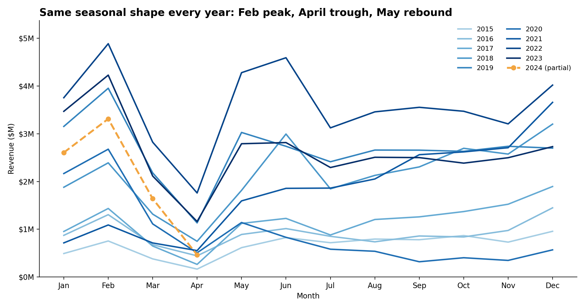
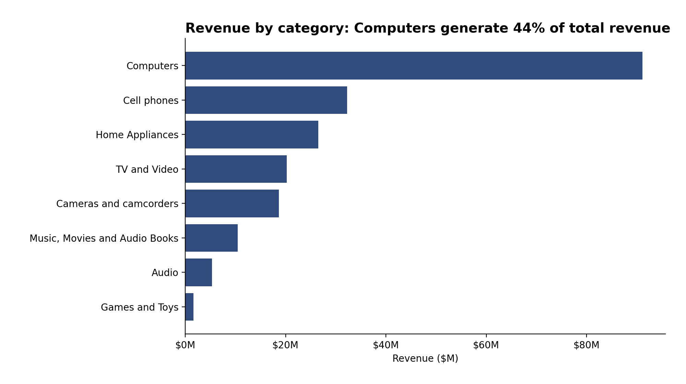
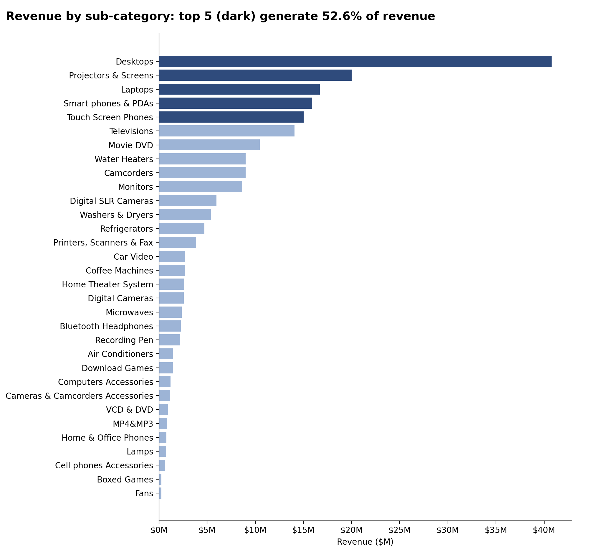
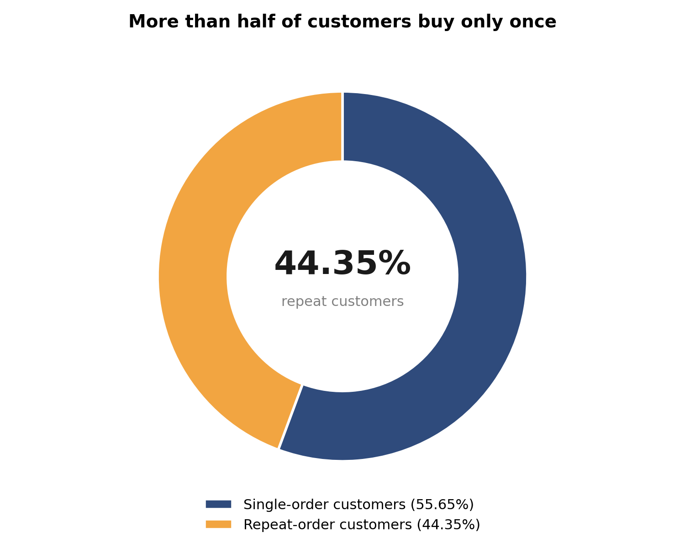
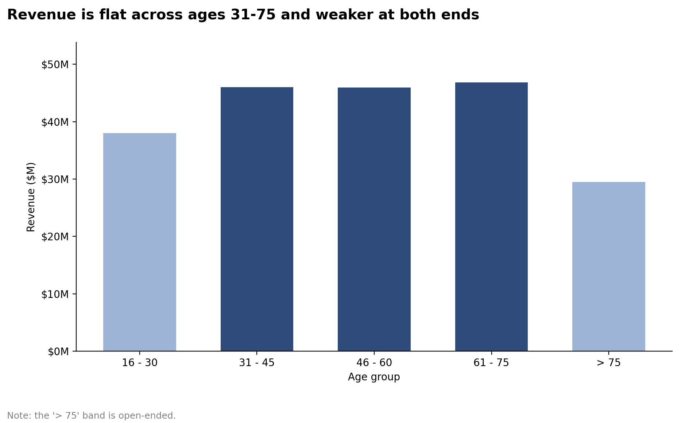
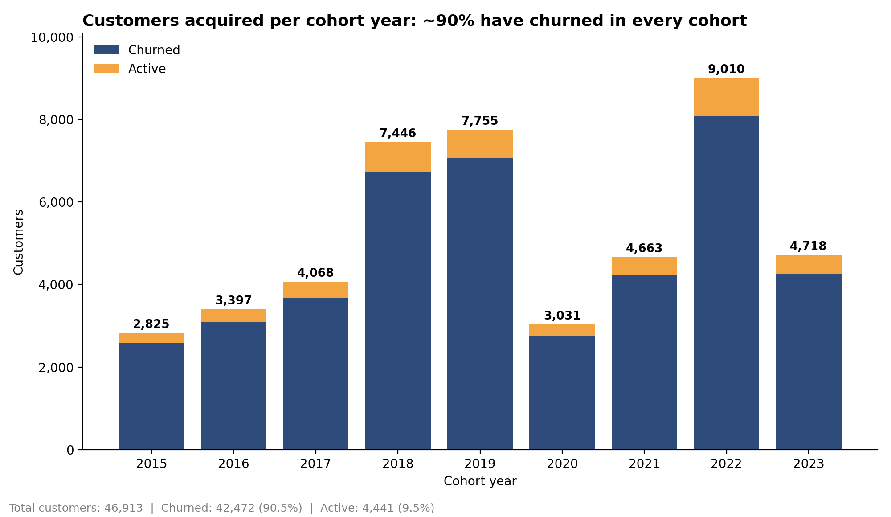
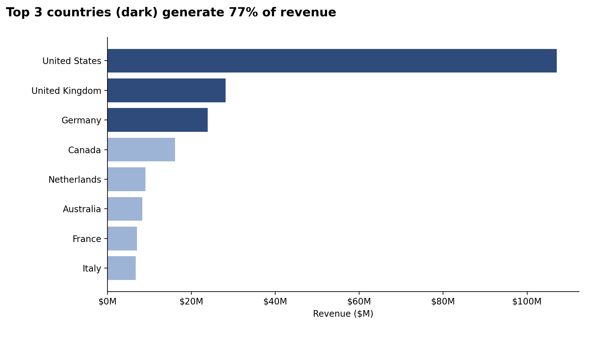
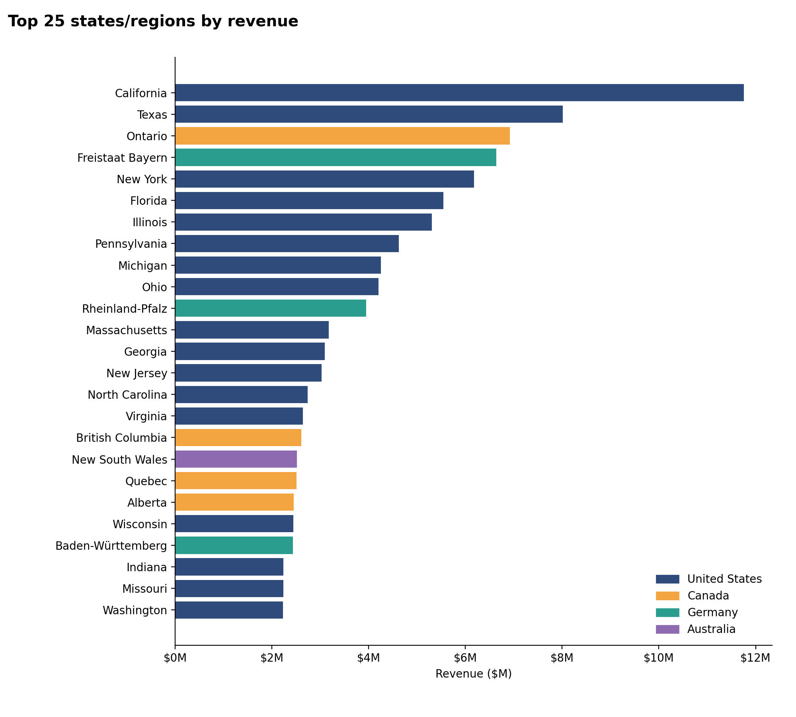

# Contoso_Sales_Analysis (SQL)

## 📌 Project Overview
This project analyzes the Contoso sales dataset covering January 2015 to April 2024 using PostgreSQL. It explores revenue trends, product and category performance, customer purchasing patterns, and sales growth over time to uncover business insights and evaluate performance across different dimensions.

## Dataset  Highlights

- **Dataset** : Contoso Sales Dataset
- **Tables Used** : Customer, Product, Sales, Date, Store, Currency Exchange
- **Records**:  More than 190,000 rows across multiple years

## Business Questions Answered

### Sales performance 
- What is total sales revenue?
- What is the average order value?
- How does revenue change month over month?
- Which months have the highest and lowest revenue?

### Product performance 
- Which categories and subcategories perform best?
- Which products sell in high quantities but generate relatively little revenue?
- How concentrated is revenue among top-selling products?

### Customer analysis 
- Who are the highest-spending customers?
- What percentage of customers place only one order vs repeat orders?
- Which age groups contribute the most revenue?
- **Customer Segmentation:** Who are our most valuable customers?
- **Cohort Analysis:** How do different customer groups generate revenue?
- **Retention Analysis:** Which customers haven't purchased recently?

### Geographic analysis 
- Which countries and states generate the highest revenue?

### 1. Total sales revenue
Query : [Total_sales_revenue](01_total_sales_revenue.sql)

### 2. Avg order value
Query : [Avg_order_value](02_avg_order_value.sql)

### 3. Month over month revenue
Query : [Month_over_revenue](03_month_over_month_revenue.sql)

**📈 Visualization:**

  

📊 **Key Findings:**
- Seasonality is strong and repeats every year: February jumps, March falls, April hits the low, and May rebounds. This holds in all 9 full years.
- February and December are the peak months. Every year's highest month is one of the two, and together they average about 23% of annual revenue.
- April is the weakest month, at about 3.3% of annual revenue and the lowest month in 8 of 9 full years (2020 was the exception, with September lowest).
- All five biggest month-over-month jumps are Mays (up to +323% in May 2017), reflecting the rebound from the April low.
- Month-over-month change is very volatile: Because of the seasonality, single-month growth figures are misleading, so same month year over year compared in visualization.
- In 2020, revenue never recovered after the March drop (-58%), and September 2020 ($0.32M) was the weakest month of that year.

### 4. Highest and Lowest revenue months
Query : [Highest_and_Lowest_revenue_months](04_highest_lowest_revenue_months.sql)

### 5. Category wise revenue
Query : [Category_wise_revenue](05_category_wise_revenue.sql)

**📈 Visualization:**

📊 **Key Findings:**
- Computers category is the highest $91.2M, 44.2% of revenue, from 23.3% of units. That is more than 2.8x the next category, Cell phones ($32.3M, 15.7%).
- The top 3 categories (Computers, Cell phones, Home Appliances) make up 72.7% of revenue, and the top 5 make up 91.5%.
- The bottom three categories (Music/Movies/Audio Books, Audio, Games and Toys) together contribute only 8.5% of revenue, despite accounting for 33.8% of units.
- Average revenue per unit shows three tiers: 
    - High value (about $440-$620): Computers ($623), Home Appliances ($498), TV and Video ($469), Cameras ($439).
    - Mid value: Cell phones ($247).
    - Low value ($26-$111): Audio ($111), Music/Movies/Audio Books ($104), Games and Toys ($26).

Query : [Category_wise_revenue_yearly](05a_category_wise_revenue_yearly.sql)

📊 **Key Findings:**
- Revenue is cyclical, peaking at $32.0M in 2019 and $42.9M in 2022, with sharp drops in 2020 (-65%) and 2023 (-27%).
- Every category fell in both 2020 and 2023, which points to a company-wide driver rather than category-specific problems.
- Computers drive the size of the swings, accounting for 60% of the 2020 drop.
- Computers' share of revenue fell from 55.0% (2019) to 35.2% (2023), reducing dependence on one category.
- Cell phones is the steadiest grower, rising from 7.9% to 18.1% of revenue between 2015 and 2023.
- Cameras and camcorders category is the weak spot: its share fell from 24.9% (2015) to 5.3% (2022).

### 6. Subcategory wise revenue
Query : [Subcategory_wise_revenue](06_subcategory_wise_revenue.sql)

**📈 Visualization:** 

### 7. High quantity low revenue
Query : [High_quantity_low_revenue](07_high_quantity_low_revenue.sql)

### 8. Highest spending customers
Query : [Highest_spending_customers](08_highest_spending_customer.sql)

### 9. Single order vs multiple order customers
Query : [Single_order_vs_multiple_order_customers](09_single_order_vs_multiple_order.sql)

**📈 Visualization:**

📊 **Key Findings:**
- 55.65% of customers are single-order customers and 44.35% are repeat-order customers, a gap of about 11 percentage points, or roughly 1.25 single-order customers for every repeat customer.
- More than half of the customers buy once and never return, which makes retention the main lever for growth.
- Repeat buyers are still a large group. Nearly 45 in every 100 customers come back, so the business has a solid loyal base to build on.

### 10. Revenue by age group
Query : [Revenue_by_age_group](10_revenue_by_age_group.sql)

**📈 Visualization:**

📊 **Key Findings:**
- With equal 15-year bands, revenue is flat across the middle three groups: 31-45 ($46.0M, 22.3%), 46-60 ($45.9M, 22.3%) and 61-75 ($46.8M, 22.7%). The gap between the highest and lowest is under $1M, about 2%.
- Those three groups together make up 67.3% of revenue.
- The two ends of the age range are weaker. 16-30 contributes $38.0M (18.4%) and over 75 contributes $29.5M (14.3%), the lowest.
- Older customers are still important in absolute terms: customers over 60 contribute $76.3M (37.0%).
- The youngest group (16-30) is the clearest growth opportunity, since it trails the middle groups despite being a core adult segment.

### 11. View
Query : [View](11_view.sql)

### 12. Customer segmentation
Query : [Customer_segmentation](12_customer_segmentation..sql)

**📈 Visualization:**

📊 **Key Findings:**
- High-value segment (25% of customers) drives 66% of revenue ($135.4M)
- Mid-value segment (50% of customers) generates 32% of revenue ($66.6M)
- Low-value segment (25% of customers) accounts for 2% of revenue ($4.3M)

💡 **Business Insights**
- High-Value (66% revenue): Offer premium membership program to 12,372 VIP customers, as losing one customer significantly impacts revenue
- Mid-Value (32% revenue): Create upgrade paths through personalized promotions, with potential $66.6M → $135.4M revenue opportunity
- Low-Value (2% revenue): Design re-engagement campaigns and price-sensitive promotions to increase purchase frequency

### 13. Cohort analysis
Query : [Cohort_analysis](13_cohort_analysis.sql)

**📈 Visualization:**

📊 **Key Findings:**
- Revenue per customer shows an alarming decreasing trend over time
  - 2022-2024 cohorts are consistently performing worse than earlier cohorts
  - NOTE: Although net revenue is increasing, this is likely due to a larger customer base, which is not reflective of customer value

💡 **Business Insights**
- Value extracted from customers is decreasing over time and needs further investigation.
- In 2023 we saw a drop in number of customers acquired, which is concerning.
- With both lowering LTV and decreasing customer acquisition, the company is facing a potential revenue decline.

### 14. Churned customers
Query : [Churned_customers](14_churned_customers.sql)

**📈 Visualization:**

📊 **Key Findings:**  
- Cohort churn stabilizes at ~90% after 2-3 years, indicating a predictable long-term retention pattern.  
- Retention rates are consistently low (8-10%) across all cohorts, suggesting retention issues are systemic rather than specific to certain years.  
- Newer cohorts (2022-2023) show similar churn trajectories, signaling that without intervention, future cohorts will follow the same pattern.  

💡 **Business Insights:**  
- Strengthen early engagement strategies to target the first 1-2 years with onboarding incentives, loyalty rewards, and personalized offers to improve long-term retention.  
- Re-engage high-value churned customers by focusing on targeted win-back campaigns rather than broad retention efforts, as reactivating valuable users may yield higher ROI.  
- Predict & preempt churn risk and use customer-specific warning indicators to proactively intervene with at-risk users before they lapse.

### 15. Country wise revenue
Query : [Country_wise_revenue](15_country_wise_revenue.sql)

**📈 Visualization:**

📊 **Key Findings:**
- The US leads with $107.0M (51.9%), 3.8x the UK, the second-largest market.
- The top 3 countries (US, UK, Germany) account for 77.1% of revenue, and the top 4 (adding Canada) for 84.9%.
- The bottom four (Netherlands, Australia, France, Italy) together contribute only 15.1%, with each between 3.3% and 4.4%.
- France and Italy are the weakest of the big European economies. Both have large populations, so the low revenue suggests room for growth.

### 16. State wise revenue
Query : [State_wise_revenue](16_state_wise_revenue.sql)

**📈 Visualization:**

📊 **Key Findings:**
- The US contributes 51.9% ($107.0M), more than the other seven countries combined.
- The top 10% of regions generate 73% of revenue, and the bottom 50% generate only about 4%.
- The median region earns $62K against a mean of $350K, so the distribution is heavily right-skewed.
- The top regions are California ($11.8M), Texas ($8.0M), Ontario ($6.9M), Bavaria ($6.6M) and New York ($6.2M).
- Single-region dependence is high in Canada (Ontario at 43% of country revenue), France (Île-de-France at 32%), Australia (NSW at 30%) and Germany (Bavaria at 28%). The US is the most diversified, with California at 11%.
- Germany earns about $1.5M per state, the highest of any non-US market, yet Berlin ($0.44M) and Hamburg ($0.48M) rank low, which suggests untapped potential.

## SQL Concepts Used

### Fundamental SQL
- `SELECT`, `WHERE`, `GROUP BY`, `ORDER BY`, `DISTINCT`
- Aggregate functions: `SUM()`, `COUNT()`, `MIN()`, `MAX()`, `AVG()`
- Type casting using `::NUMERIC`

###  Joins and Subqueries
- `INNER JOIN`, Common Table Expressions (CTEs) 

### Window Functions
- `ROW_NUMBER()`, `LAG()`, `MIN() OVER()`, `MAX() OVER()`, `SUM() OVER()`, `PERCENTILE_CONT()`, `PARTITION BY`

### Conditional Logic 
- `CASE WHEN`, Conditional aggregation
- Date Analysis: `INTERVAL`, `EXTRACT()`
- Calculations:  `NULLIF()`, `ROUND()`
- Data transformation  `VIEW `, `TRIM()` and `CONCAT()`
